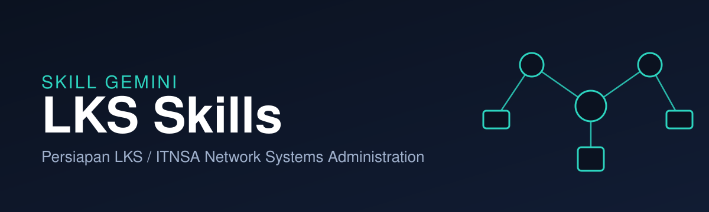

<p align="center">
  
</p>

<h1 align="center">LKS Skills untuk Gemini</h1>

<p align="center">
  Empat skill kustom untuk persiapan <b>LKS / ITNSA</b> bidang jaringan.<br>
  Langkah konfigurasi yang bisa diverifikasi, diagnosis berbasis bukti, belajar bertahap, dan cheatsheet yang akurat.
</p>

<p align="center">
  
  
  
  
</p>

---

## Kenapa skill ini

AI sering menjawab soal jaringan dengan konfigurasi yang kelihatan meyakinkan, tetapi IP-nya dikarang, tanpa langkah pembuktian, atau tidak menyebut lab yang offline. Skill di sini memaksa Gemini bekerja seperti peserta yang disiplin: ikuti data soal, buktikan setiap langkah, dan jujur saat tidak yakin.

## Isi

| Skill | Dipakai untuk | Panggil dengan |
|---|---|---|
| [`lks-asisten`](lks-asisten/SKILL.md) | Langkah konfigurasi Debian, MikroTik, Cisco, Windows Server, dan Ansible, lengkap dengan verifikasi | `@lks-asisten` |
| [`lks-troubleshooting`](lks-troubleshooting/SKILL.md) | Diagnosis berurutan dari output perintah, plus mode latihan skenario rusak | `@lks-troubleshooting` |
| [`lks-mentor`](lks-mentor/SKILL.md) | Belajar dengan petunjuk bertahap, kuis, dan simulasi ujian | `@lks-mentor` |
| [`lks-cheatsheet`](lks-cheatsheet/SKILL.md) | Ringkasan perintah satu halaman per topik | `@lks-cheatsheet` |

## Sebelum dan sesudah

| Situasi | Tanpa skill (biasanya) | Dengan skill |
|---|---|---|
| Data soal kurang lengkap | Mengarang IP dan nama domain | Memakai placeholder seperti `<IP-DNS>` atau bertanya |
| Menjawab konfigurasi | Hanya konfigurasi | Setiap langkah punya perintah verifikasi dan hasil yang diharapkan |
| Lab offline | `apt install` dari internet | Menanyakan repo lokal atau paket yang tersedia |
| Router Cisco | Lupa `no shutdown` dan menyimpan konfigurasi | Selalu menyertakan keduanya |
| Gagal ping | Menebak penyebab | Meminta output perintah, lalu menunjuk bukti |
| Belajar | Langsung memberi jawaban lengkap | Petunjuk bertahap, siswa menjawab dulu |

### Contoh: `lks-troubleshooting`

Input:

```
@lks-troubleshooting Ping dari R1 ke R2 (10.0.0.2) gagal.

R1# show ip interface brief
GigabitEthernet0/0  192.168.1.1  YES manual up                    up
GigabitEthernet0/1  10.0.0.1      YES manual administratively down down
```

Pola jawaban:

```
Gejala:     Ping R1 ke R2 gagal; sisi R2 belum diketahui
Penyebab:   Gi0/1 pada R1 dalam keadaan shutdown (pasti, terlihat di output)
Bukti:      GigabitEthernet0/1 10.0.0.1 ... administratively down down
Perbaikan:  interface gi0/1 -> no shutdown
Cek:        show ip interface brief -> up/up, lalu ping 10.0.0.2
Pencegahan: simpan konfigurasi (copy running-config startup-config)
```

## Cara pakai di Gemini

1. Buka Gemini, lalu **Customize** > **Keahlian** > **Upload keahlian**.
2. Upload **satu folder skill** (isinya `SKILL.md`). Nama skill di dalam `SKILL.md` memakai kebab-case.
3. Panggil di chat dengan `@nama-skill`.

Contoh prompt:

```
@lks-asisten Buat playbook Ansible untuk memasang Apache di VM2 (192.168.10.2). Debian 12, lab offline.
@lks-mentor Ajari saya OSPF. Saya baru paham static route.
@lks-cheatsheet Cheatsheet OSPF Cisco satu halaman.
```

## Struktur repositori

```
lks-skills/
├── README.md
├── assets/
│   └── banner.svg
├── lks-asisten/SKILL.md
├── lks-troubleshooting/SKILL.md
├── lks-mentor/SKILL.md
└── lks-cheatsheet/SKILL.md
```

## Catatan

- Skill hanya membuat jawaban lebih disiplin; **tidak menjamin konfigurasi benar**. Uji perintah di lab (Packet Tracer, EVE-NG, atau VM) sebelum dipakai.
- Gemini bisa membuat kesalahan, terutama sintaks yang bergantung versi (misalnya RouterOS v6 vs v7).
- Skill ini dibuat untuk **latihan dan pembinaan**. Ikuti aturan lomba tentang penggunaan alat bantu saat kompetisi.
- Output PDF bergantung pada fitur yang aktif di akun Gemini; bila tidak bisa membuat file, skill menyusun dokumen siap cetak untuk disimpan sebagai PDF.

## Kontribusi

Menemukan perintah yang salah atau punya ide skill baru? Buka **Issue** atau kirim **Pull Request**.
